# CookieKub — симулятор магазина печенек

Публичный учебный проект: витрина пекарни, корзина, промокоды, «оплата» без реальных денег,
заказы гостя и пользователя, страница заказа с вымышленным кафе и картой, кабинет **KubanoID**
и полностью самописная админ-панель.

> Это не настоящий магазин. Платёжные данные не проверяются и не сохраняются: сервер получает
> только последние 4 цифры и факт «оплаты». Письма поддержки тоже имитируются.

## Стек

- **Backend:** Python 3.12, Flask 3, psycopg 3, Gunicorn.
- **База:** PostgreSQL 17 (локально — portable-сборка, в продакшене — Neon).
- **Frontend:** чистые HTML/CSS/JS без сборщика; шрифты Comfortaa/Manrope лежат в репозитории.
- **Тесты:** pytest (31 тест), Playwright + Edge для e2e и скриншотов.
- **Деплой:** GitHub Pages (статика) + Render Free (Flask) + Neon Free (PostgreSQL).

GitHub Pages умеет отдавать только статические файлы, поэтому Python-бэкенд живёт отдельно на
Render, а фронтенд обращается к нему по `apiBase` из `frontend/js/config.js`.

## Демо-доступы

| Роль | Email | Пароль |
|---|---|---|
| Администратор | `admin@cookiekub.ru` | `Admin123!` |
| Пользователь | `user@cookiekub.ru` | `User123!` |

Промокоды из сида: `COOKIE10` (−10%), `FIRST15` (−15% от 500 ₽), `SWEET500` (−500 ₽ от 1500 ₽),
`KUB20` (−20% от 2000 ₽, лимит 50 использований).

## Скриншоты

| Страница | Скриншот |
|---|---|
| Главная | 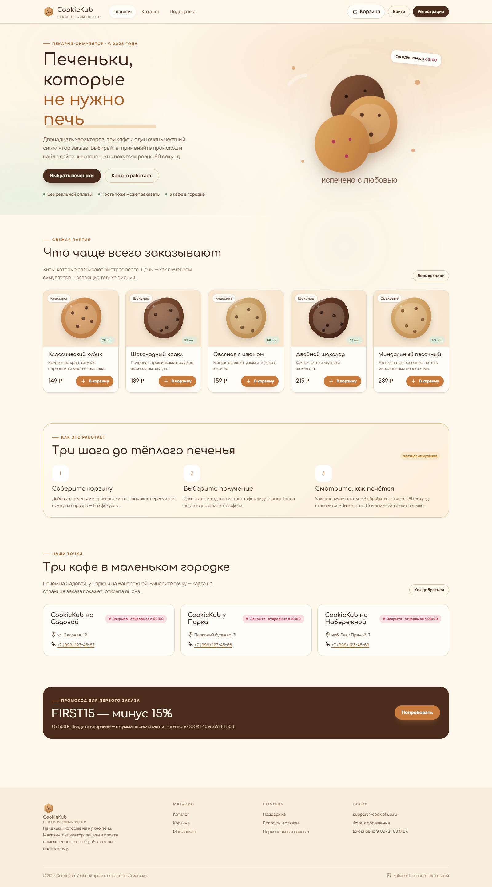 |
| Каталог, 5 карточек в ряд | 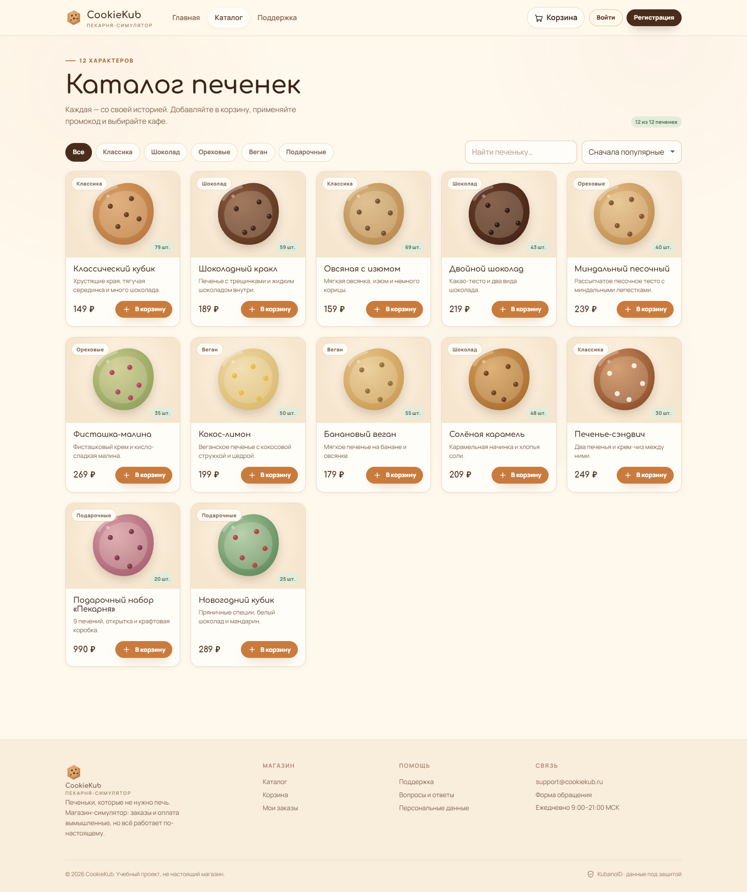 |
| Корзина с промокодом | 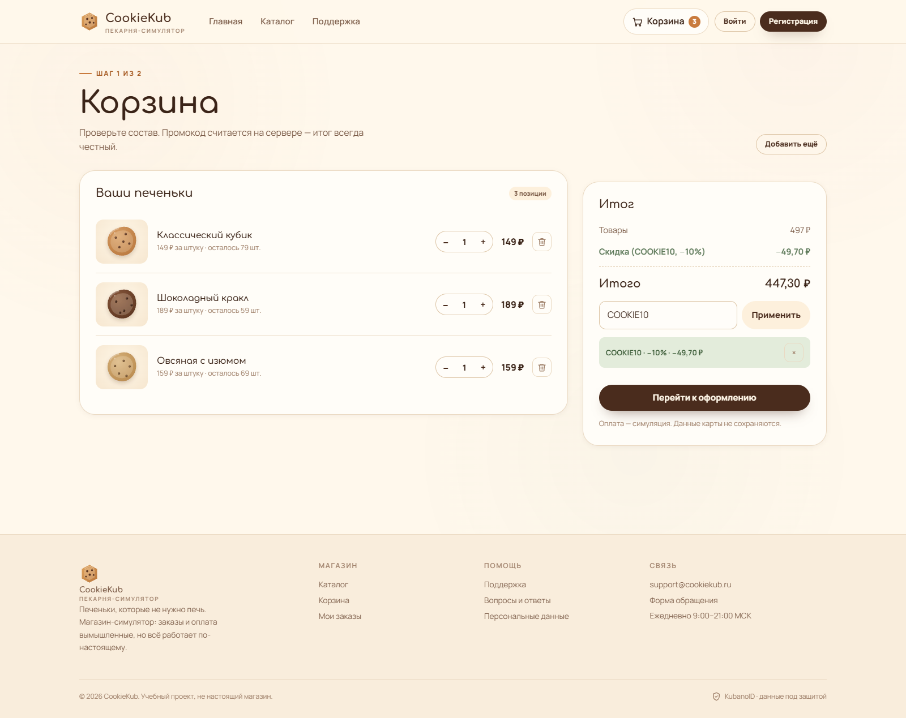 |
| Оформление заказа | 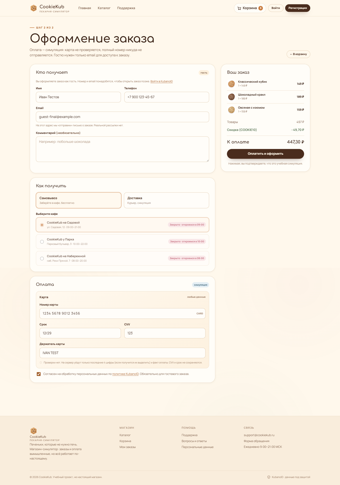 |
| Заказ: успех и статус | 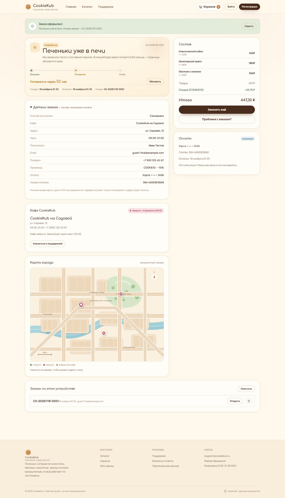 |
| Вход KubanoID | 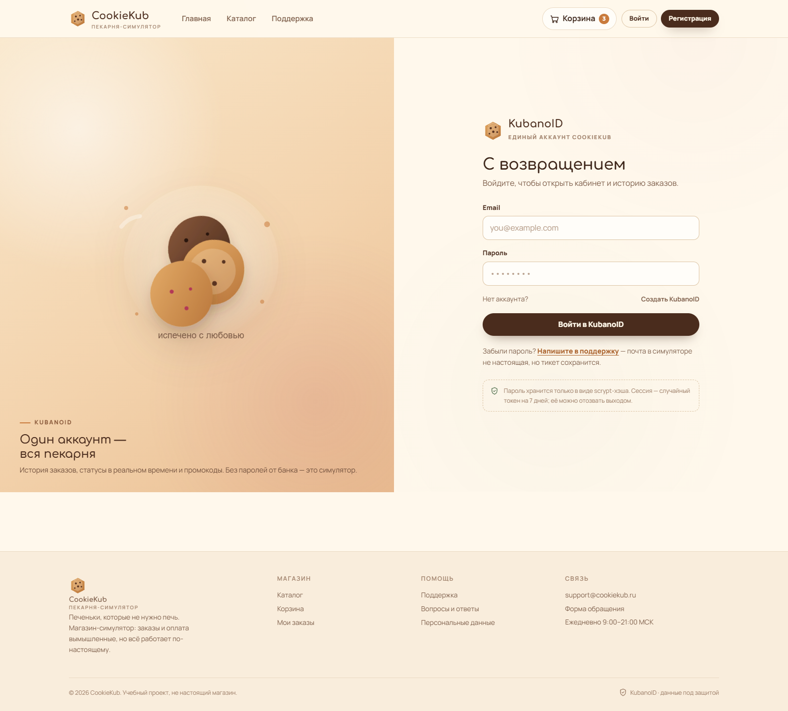 |
| Регистрация | 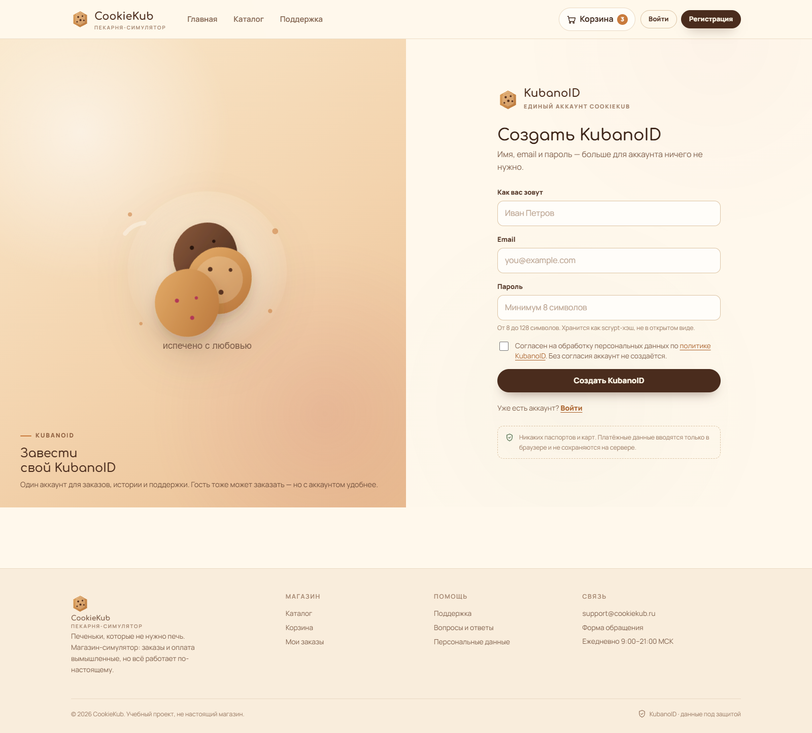 |
| Личный кабинет | 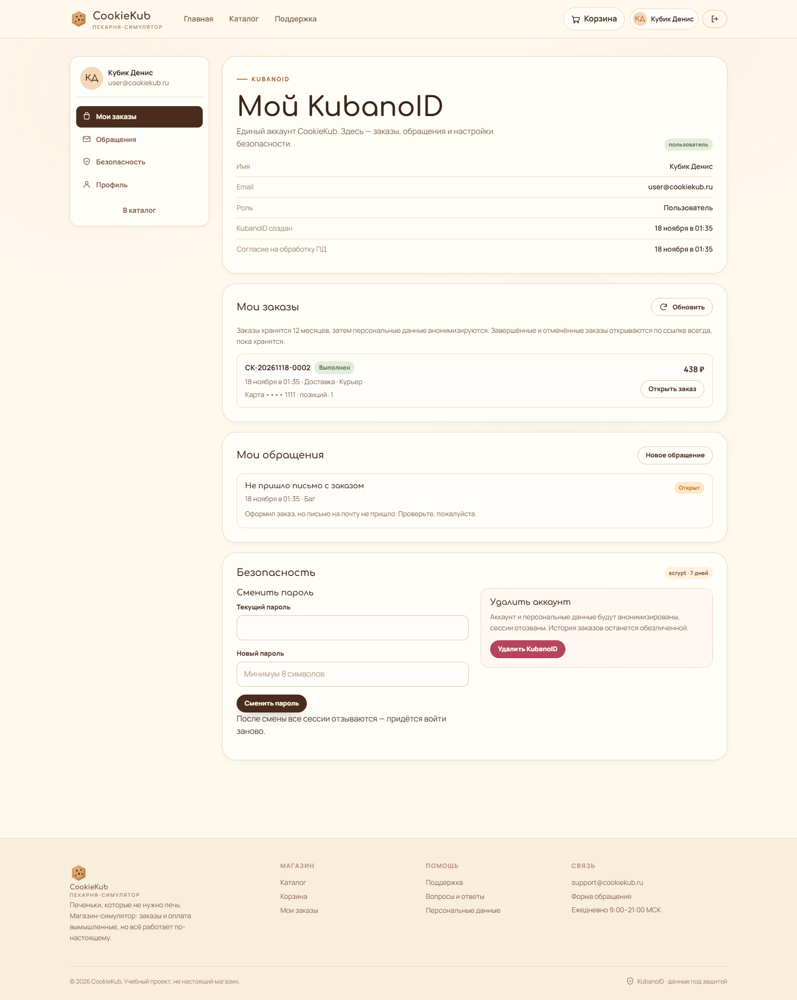 |
| Поддержка | 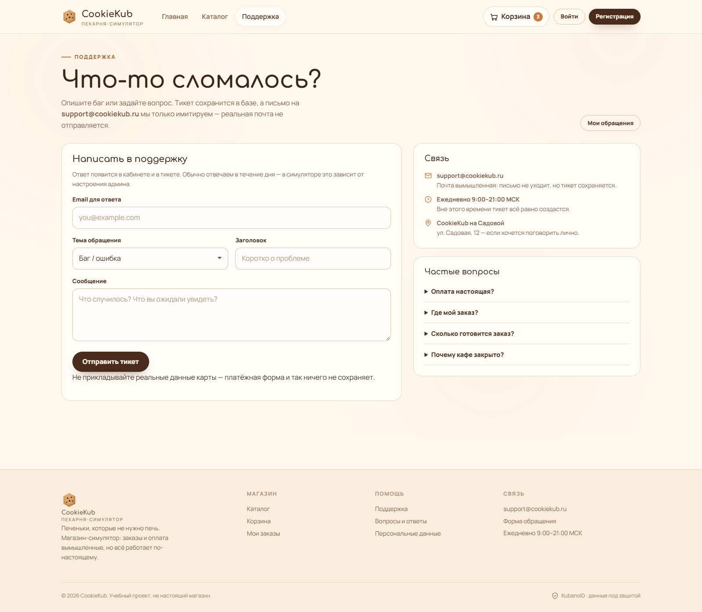 |
| Админ-панель | 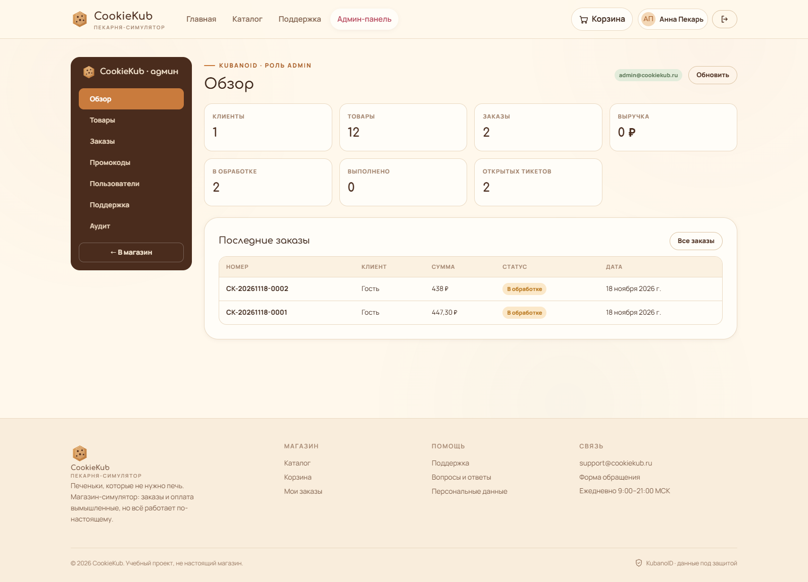 |
| 403 для гостя | 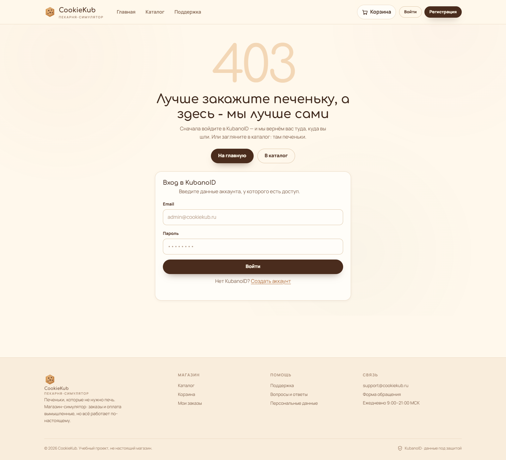 |
| 404 | 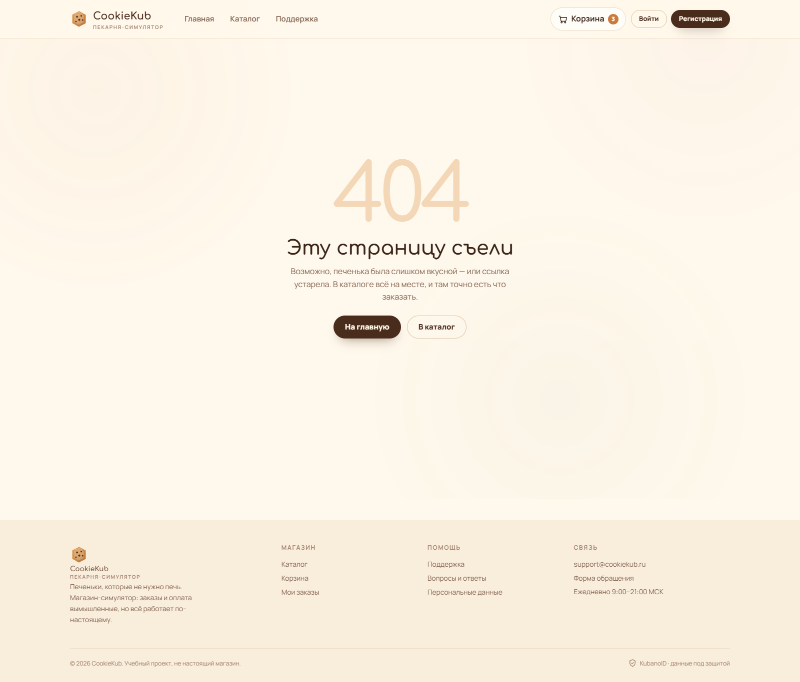 |

Дополнительно: `docs/screenshots/e2e-order-completed.png` и
`docs/screenshots/e2e-order-cancelled.png` — статусы после действий администратора.

## Архитектура

- [Архитектура и безопасность](docs/architecture/cookiekub-architecture.html)
- [ERD: 11 таблиц PostgreSQL](docs/architecture/cookiekub-erd.html)
- [Жизненный цикл заказа](docs/architecture/cookiekub-order-lifecycle.html)
- [SQL-дамп схемы](docs/schema.sql)

Кратко: браузер → GitHub Pages (статика) → Flask API на Render → PostgreSQL на Neon.
Гость заказывает без входа, но указывает email; пользователь видит заказы в кабинете.
Админка защищена ролью на API, а не «скрытой ссылкой».

## Локальный запуск

### 1. PostgreSQL

Можно использовать любой локальный PostgreSQL 15+. В проекте проверялась portable-сборка 17.6
на порту `5433` с trust-аутентификацией:

```bash
# данные лежат вне репозитория, например F:\CodeProject\.pg
initdb -D F:\CodeProject\.pg\data -U postgres -A trust -E UTF8 --locale=C
pg_ctl -D F:\CodeProject\.pg\data -o "-p 5433 -h 127.0.0.1" start
createdb -h 127.0.0.1 -p 5433 -U postgres cookiekub
createdb -h 127.0.0.1 -p 5433 -U postgres cookiekub_test
```

### 2. Python

```bash
python -m venv .venv
# Windows: .venv\Scripts\activate
# Linux/macOS: source .venv/bin/activate
pip install -r backend/requirements-dev.txt
```

Если PostgreSQL на другом порту/хосте, скопируйте `.env.example` в `.env` и поправьте
`DATABASE_URL`. Без `.env` используется `postgresql://postgres@127.0.0.1:5433/cookiekub`.

### 3. Миграции, сид и запуск

```bash
python -m backend.db.migrate
python -m backend.db.seed
python -m flask --app backend.app run --host 127.0.0.1 --port 5000
```

Откройте <http://127.0.0.1:5000>. Flask раздаёт и API, и статику из `frontend/`.

### 4. Тесты

```bash
pytest -q
```

Тесты используют `cookiekub_test` и полностью пересоздают схему. Для отдельной БД:

```bash
TEST_DATABASE_URL=postgresql://postgres@127.0.0.1:5433/cookiekub_test pytest -q
```

### 5. E2E и скриншоты

Нужен установленный Microsoft Edge и запущенный Flask на `127.0.0.1:5000`:

```bash
python scripts/reset_db.py
python scripts/e2e_guest_order.py
python scripts/final_screenshots.py
```

## API (кратко)

| Метод | Путь | Назначение |
|---|---|---|
| GET | `/api/health` | health + проверка БД |
| GET | `/api/products` | каталог, фильтры `category`, `search` |
| GET | `/api/products/<slug>` | карточка товара |
| GET | `/api/cafes` | 3 кафе, `is_open`, координаты |
| POST | `/api/promos/validate` | проверка промокода по сумме |
| POST | `/api/auth/register` | регистрация KubanoID |
| POST | `/api/auth/login` | вход, bearer-токен |
| GET | `/api/auth/me` | текущий пользователь |
| POST | `/api/auth/logout` | отзыв сессии |
| POST | `/api/auth/change-password` | смена пароля + отзыв сессий |
| DELETE | `/api/auth/account` | анонимизация аккаунта |
| POST | `/api/orders` | заказ гостя/пользователя, «оплата» |
| GET | `/api/orders` | мои заказы |
| POST | `/api/orders/lookup` | гость: номер + email |
| GET | `/api/orders/<number>` | заказ владельцу/админу |
| POST | `/api/tickets` | тикет поддержки |
| GET | `/api/tickets/my` | мои тикеты |
| GET | `/api/admin/stats` | сводка админки |
| CRUD | `/api/admin/products` | товары, удаление = архив |
| GET/PATCH/DELETE | `/api/admin/users/...` | роли, блокировка, анонимизация |
| GET/PATCH | `/api/admin/orders/...` | заказы, завершение/отмена |
| CRUD | `/api/admin/promos` | промокоды |
| GET/PATCH | `/api/admin/tickets/...` | ответы поддержки |
| GET | `/api/admin/audit` | журнал действий |
| POST | `/api/maintenance/purge` | retention по токену |

Деньги везде в копейках. Ошибки API имеют вид
`{"error": {"code": "...", "message": "...", "details": {...}}}`.

## Безопасность и приватность

- Пароли — scrypt; токены сессий — 256 бит, в БД только SHA-256, TTL 7 дней.
- При выходе, блокировке и смене пароля сессии отзываются.
- Логин отвечает одинаково для неверного email и пароля; есть rate-limit на логин, промокоды,
  lookup заказа и тикеты.
- Карта: принимается любой текст, на сервер уходят только `last4`, CVV/срок не сохраняются.
- CORS — allowlist, CSP — meta на страницах, XSS — через `textContent`, SQL — параметризован.
- `admin_audit` не содержит PII; гость и тикеты хранятся 12 месяцев, сессии — 7 дней.
- Самоудаление аккаунта анонимизирует пользователя и обезличивает его заказы/тикеты.

## Деплой

Подробная пошаговая инструкция — [docs/DEPLOY.md](docs/DEPLOY.md). Кратко:

1. Создать публичный репозиторий GitHub и включить Pages через Actions.
2. Создать бесплатную БД Neon и скопировать **pooled** connection string с `sslmode=require`.
3. Создать Render Web Service из `render.yaml`, задать `DATABASE_URL`, `CORS_ORIGINS`.
4. В `frontend/js/config.js` указать фактический URL Render, если он отличается от
   `https://cookiekub-api.onrender.com`.
5. Запушить в `main`: workflow `pages.yml` соберёт `frontend/` и опубликует сайт.

## Структура

```
backend/            Flask API, безопасность, сериализаторы
  db/               миграции/сид-раннеры
db/migrations/      001_init.sql, 002_indexes.sql
frontend/           HTML/CSS/JS, шрифты и SVG
docs/               архитектура, ERD, схема, скриншоты
tests/              pytest (31 тест)
scripts/            reset/e2e/screenshots/dev-проверки
.github/workflows/  Pages, CI, keepalive, purge
```

## Известные ограничения симулятора

- Письма не отправляются: поддержка показывает тикет и «письмо отправлено» только как текст.
- Пароль нельзя восстановить по email — только обратиться в поддержку (симуляция).
- Заказ становится «Выполнен» лениво: при открытии страницы/запросе списка после 60 секунд,
  либо кнопкой администратора.
- Render Free засыпает через ~15 минут; первый запрос может занять до минуты. Workflow
  `keepalive.yml` пингует health каждые 10 минут, но GitHub может задерживать расписание.

© 2026 CookieKub. Учебный проект.
